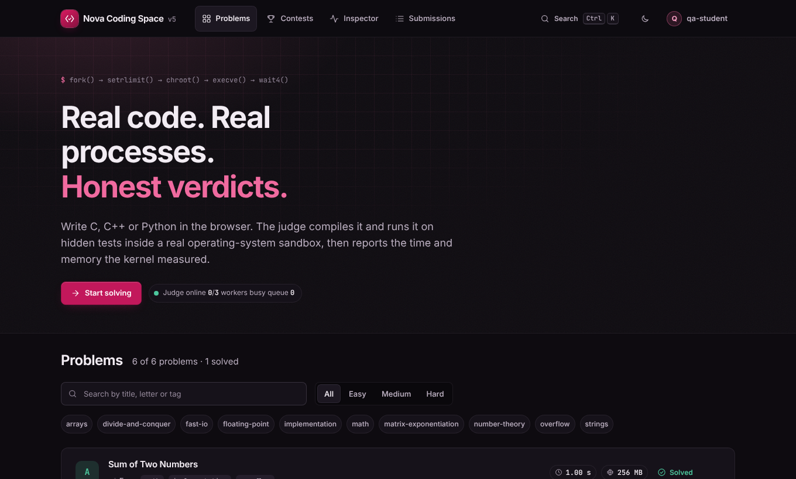
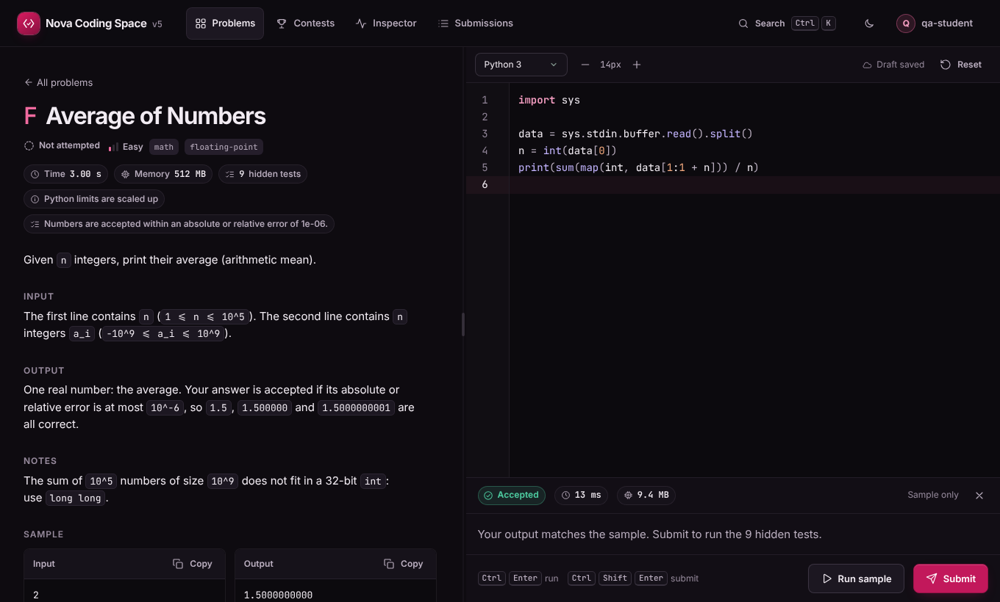
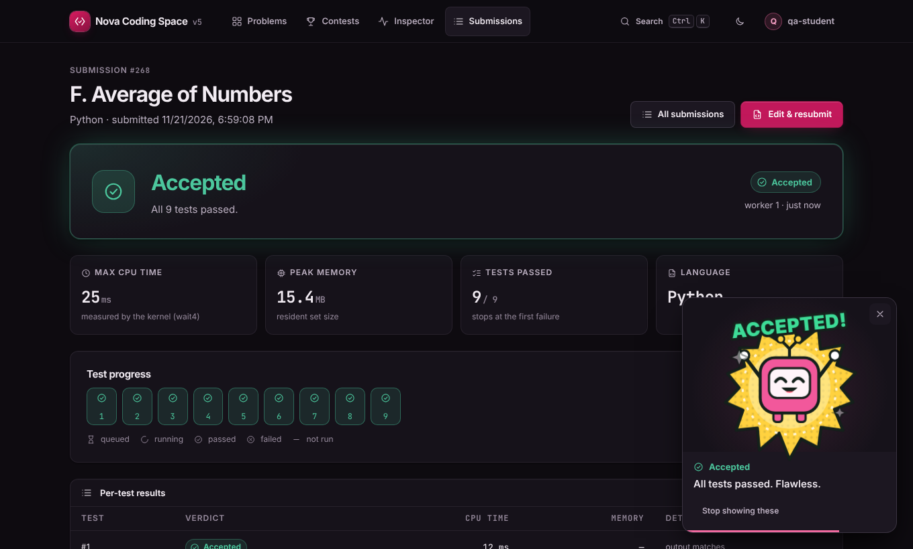
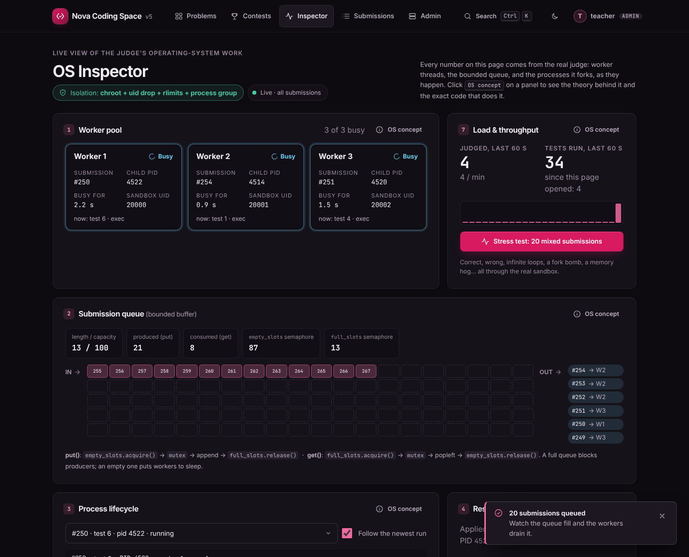
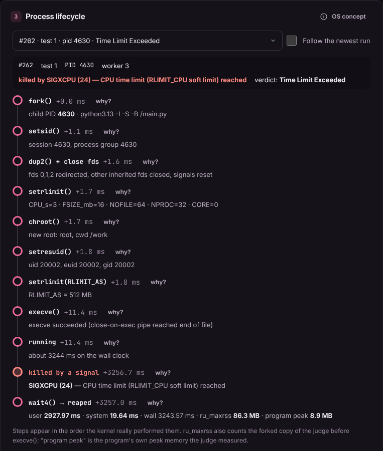
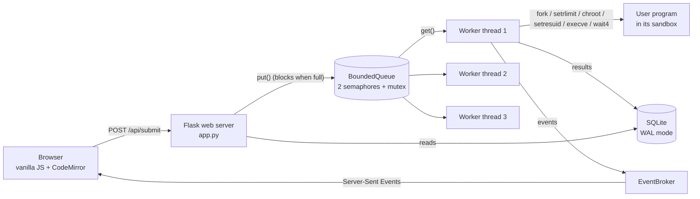

# Nova Coding Space

[](https://github.com/morouj-mohamed/online-code-judge/actions/workflows/tests.yml)

**An online code judge built for an Operating Systems course.** Students submit C, C++ or Python; the
server compiles and runs every submission inside an isolated sandbox using the real system calls —
`fork()`, `setsid()`, `setrlimit()`, `chroot()`, `setresuid()`, `execve()`, `wait4()`, `killpg()` — and
streams the verdict live. An **OS Inspector** page shows the operating-system work as it happens: worker
threads, a bounded queue guarded by semaphores, and the life of every process, with the exact signal that
ended it.



| | |
|---|---|
|  |  |
|  |  |

---

## Contents
1. [Features](#features)
2. [The operating-system concepts, and where they are in the code](#the-operating-system-concepts-and-where-they-are-in-the-code)
3. [Architecture](#architecture)
4. [The life of one submission](#the-life-of-one-submission)
5. [Verdicts](#verdicts)
6. [Security model](#security-model)
7. [Run it](#run-it)
8. [Tests](#tests)
9. [Configuration](#configuration)
10. [Backup and restore](#backup-and-restore)
11. [Putting it on a server](#putting-it-on-a-server)
12. [Project layout](#project-layout)

---

## Features

**For students**
- Problem list with search, difficulty and tag filters, a command palette (`Ctrl+K`), dark and light themes.
- In-browser editor (CodeMirror 6) for **C, C++ and Python**: templates, drafts saved automatically,
  `Ctrl+Enter` runs the public sample (with a line-by-line diff), `Ctrl+Shift+Enter` submits.
- Live result page: tests light up one by one over Server-Sent Events, time and memory measured by the kernel,
  the process lifecycle of the run, and a comic **reaction sticker** for the verdict (can be turned off).
- Accounts (or anonymous use: what you solved comes with you when you sign up), change your own password.
- Contests with ICPC standings (penalty: minute of each first Accepted + 20 per rejected try), live
  **announcements** from the teacher.
- Accessible: WCAG 2.2 AA colours and focus rings, keyboard-only use, screen-reader labels, reduced motion,
  phones from 320 px wide (checked with axe-core on every page).

**For teachers (admins)**
- Create problems with a Markdown statement and pictures, upload hidden tests as a ZIP, check them with a
  reference solution, then publish.
- **Answer checking** per problem: exact, word by word, or real numbers with a tolerance (e.g. `1e-6`).
- **Rejudge** one submission or every submission of a problem after fixing the tests.
- Contests and **exam mode**: fullscreen, every exit (other tab, other program, leaving fullscreen) and every
  large paste is recorded; after N exits the exam is locked on the server until the teacher unlocks it.
- Class accounts in bulk (paste names or a CSV → printable password sheet), password reset, a page per student.
- **Similarity check** (MOSS-style winnowing over normalized tokens) with a side-by-side view of shared lines.
- Verdict reactions: upload your own GIFs / short videos per verdict.
- Backups of everything with one command.

**OS Inspector** (`/inspector`) — every number comes from the running judge, nothing is animated for show:
worker pool, the bounded queue with its two semaphores and mutex, the process lifecycle of any run
(`fork → setsid → dup2 → setrlimit → chroot → setresuid → setrlimit(RLIMIT_AS) → execve → exit / signal → wait4`),
the exact rlimits applied, the isolation level, a filterable event log, a stress test, and an
"OS concept" drawer that links each panel to the function that implements it.

## The operating-system concepts, and where they are in the code

| Concept | What the judge does | Where |
|---|---|---|
| **Processes** | `fork()` a child per compile / test, `execve()` the program, `wait4()` for the exit status **and** the rusage (CPU time, max RSS); every zombie is reaped | `judge/sandbox.py` → `_spawn()`, `_child_main()`, `_reap_group()` |
| **Process groups & signals** | `setsid()` gives each run its own group; the watchdog sends `killpg(pgid, SIGKILL)` when the wall clock runs out **or when the whole group has used its CPU share** (summed from `/proc/<pid>/stat`: `RLIMIT_CPU` alone is per process, so a 32-process fork bomb used to burn 8.5 s of CPU and starve other students' programs — now 1.7 s); the kernel sends `SIGXCPU` at the CPU limit, `SIGSEGV`, `SIGFPE`, `SIGXFSZ`…; `WIFSIGNALED/WTERMSIG` turn them into verdicts | `_kill_group()`, `_group_cpu_s()`, `classify_run()` |
| **Orphans** | the judge is a *subreaper* (`PR_SET_CHILD_SUBREAPER`), so grandchildren of a fork bomb come back to it and are reaped | `_become_subreaper()` |
| **Resource limits** | `setrlimit()`: `RLIMIT_CPU`, `RLIMIT_AS` (applied last), `RLIMIT_FSIZE`, `RLIMIT_NOFILE`, `RLIMIT_NPROC`, `RLIMIT_CORE`; per-language multipliers | `_child_main()`, `config.effective_limits()` |
| **Isolation** | `chroot()` into a per-run jail, then `setgroups/setresgid/setresuid` to an unprivileged uid (one per worker); probed at start-up and reported honestly | `_probe_isolation()`, `Sandbox._create_dirs()` |
| **Files & descriptors** | `dup2()` connects stdin/stdout/stderr to files; every other inherited descriptor is closed; the Python jail is built with hard links | `_close_inherited_fds()`, `_link_tree()` |
| **IPC** | a close-on-exec pipe tells the parent each setup step and whether `execve()` succeeded (end-of-file = success); an event broker fans events out to every browser over SSE | `_child_main()` (`say()`), `judge/events.py` |
| **Threads & synchronization** | a pool of worker threads consumes a **bounded buffer** built from two counting semaphores and a mutex (classic producer–consumer); a database compare-and-swap makes sure exactly one worker claims a submission | `judge/queue.py` → `BoundedQueue`, `judge/worker.py` → `WorkerPool`, `db.claim()` |
| **Memory** | `ru_maxrss` also counts the judge's copy before `execve()`, so the judge measures that floor and samples `/proc/<pid>/status` (`VmHWM`) for the program's real peak | `_measured_memory()`, `_read_vm()` |
| **Graceful shutdown & recovery** | `SIGTERM` / `Ctrl+C` stop the pool after the running submissions; at start-up interrupted ones are put back in the queue | `app.py` (signal handlers), `db.recover_interrupted()` |

The Inspector's "OS concept" drawer reads these locations from the running code (`inspect`), so its
links always point at the right line.

## Architecture



- **Web server** (`app.py`): JSON API, pages, SSE stream, accounts, admin, contests. It never runs user code
  itself: it only creates a row and puts its id in the queue.
- **Bounded queue** (`judge/queue.py`): a full queue blocks producers (back-pressure) instead of growing
  memory; rejudging 218 submissions through a 100-slot queue is fine.
- **Worker pool** (`judge/worker.py`): N threads (default 3); each blocks in `wait4()` while its child runs,
  which releases Python's global lock, so judging really happens in parallel.
- **Sandbox** (`judge/sandbox.py`): everything between `fork()` and the verdict.
- **Database** (`judge/db.py`): one SQLite file in WAL mode, one connection guarded by a lock.
- **Events** (`judge/events.py`): an in-memory pub/sub with sequence numbers, so a browser that reconnects
  replays what it missed (`Last-Event-ID`).

## The life of one submission

1. The browser POSTs the code; the server checks the size and rate limits, stores a `Pending` row and calls
   `queue.put(id)` (`empty_slots.acquire() → mutex → append → full_slots.release()`).
2. A worker's `queue.get()` wakes up; it claims the row with `UPDATE … WHERE status = 'Pending'`.
3. **Compile** (C/C++): `gcc`/`g++ -O2 -static` in its own sandboxed process with limits.
4. For every test: `fork()` → `setsid()` → `dup2()` the test files onto 0/1/2 → `setrlimit()` →
   `chroot()` → `setresuid()` → `setrlimit(RLIMIT_AS)` → `execve()`. The parent waits with `wait4()`, while a
   watchdog kills the whole group if the wall clock runs out.
5. The exit status and rusage decide the verdict; the output is compared with the expected one; judging stops
   at the first failing test.
6. Every step is stored and published; the browser shows it live; the reaction sticker pops up.

## Verdicts

| Verdict | How it is decided |
|---|---|
| **Accepted** | every test exits with code 0 and the output matches |
| **Wrong Answer** | the output differs (the message says the first differing line; hidden test data is never shown) |
| **Time Limit Exceeded** | CPU time over the limit (`SIGXCPU`, or the measured time), or the wall-clock watchdog fired (`SIGKILL`) |
| **Memory Limit Exceeded** | the program ran out of address space (`RLIMIT_AS`) or its peak memory passed the limit |
| **Runtime Error** | killed by a signal (`SIGSEGV`, `SIGFPE`, `SIGABRT`…) or a non-zero exit code |
| **Compilation Error** | the compiler failed; its output is shown |

Python gets 3× the time and 2× the memory of C/C++ (`config.py → LANGUAGES`).

## Security model

- User code runs as an unprivileged uid inside a `chroot` jail with its own process group, hard rlimits
  and a wall-clock watchdog. A fork bomb hits `RLIMIT_NPROC`, the container's `pids_limit` and `killpg()`.
- The Docker container drops **every** Linux capability and adds back only the seven the judge uses
  (`SYS_CHROOT, SETUID, SETGID, KILL, CHOWN, DAC_OVERRIDE, FOWNER`), with `no-new-privileges`.
- Hidden tests never leave the server: messages are rewritten (`public_message()`) so neither the expected
  output nor the input (a program could copy stdin to stderr and crash) can leak.
- Passwords: salted scrypt hashes; login tokens stored as SHA-256; `HttpOnly` cookies; rate limits on login,
  submit and sample runs; Origin check on every state-changing request; strict Content-Security-Policy
  (`script-src 'self'`); uploads are type-checked from their bytes (no SVG/HTML).

## Run it

You need **Docker Desktop** (Windows: with WSL 2) and Git.

```bash
git clone https://github.com/morouj-mohamed/online-code-judge.git
cd online-code-judge
docker compose up --build
```

Open <http://127.0.0.1:5000> (or `https://127.0.0.1:5000` with the self-signed certificate: *Advanced →
Continue*). In a second terminal, create the first teacher account once:

```bash
docker compose exec judge python3 tools/manage_users.py create-admin teacher
```

Stop with `Ctrl+C` (running submissions finish first). Data lives in the `judge-data` Docker volume and
survives rebuilds.

Without Docker (Linux; root is needed for chroot/setuid, and `gcc`, `g++`, `libc6-dev` must be installed):

```bash
python3 -m venv .venv && .venv/bin/pip install -r requirements.txt
sudo .venv/bin/python app.py
```

## Tests

All of these also run automatically on every push (GitHub Actions, badge at the top).

| Command | What it checks |
|---|---|
| `docker compose run --rm judge python3 tools/run_verdict_tests.py --reference` | every verdict (infinite loop, fork bomb, memory hog, file-write bomb, segfault, division by zero…) and the reference solutions of all problems |
| `docker compose run --rm judge python3 tools/test_concurrency.py` | worker pool, bounded queue, back-pressure, no lost or doubled submissions, no zombies |
| `docker compose exec judge python3 tools/api_smoke_test.py` | the whole HTTP API: 103 checks (privacy of hidden tests, accounts, admin, contests, SSE, rate limits) |
| `docker compose exec judge python3 tools/stress.py --plain` | 20 mixed submissions at once, each with its expected verdict |

`TESTING.md` is the manual checklist (100 numbered items) for everything in the user interface.
`docs/PRESENTATION.md` (Arabic) explains the whole project for a presentation: the OS concepts, every page, a demo script and likely questions.

## Configuration

Set these as environment variables (e.g. in `docker-compose.yml`):

| Variable | Default | Meaning |
|---|---|---|
| `JUDGE_SITE_NAME` | `Nova Coding Space` | name in the header, titles and footer |
| `JUDGE_WORKERS` | `3` | worker threads (parallel judgings) |
| `JUDGE_QUEUE_CAPACITY` | `100` | bounded queue size |
| `JUDGE_DB` | `judge.sqlite3` | database file (Docker: `/data/judge.sqlite3`) |
| `JUDGE_PROBLEMS_DIR` | `./problems` | statements, tests and pictures |
| `JUDGE_ALLOW_SIGNUP` | `1` | `0` = only the teacher creates accounts |
| `JUDGE_COOKIE_SECURE` | `0` | `1` behind real HTTPS |
| `JUDGE_HOST` / `JUDGE_PORT` | `127.0.0.1` / `5000` | where the server listens |
| `JUDGE_COURSE`, `JUDGE_INSTITUTION`, `JUDGE_TEAM`, `JUDGE_YEAR` | | footer text |

Time/memory multipliers per language, rlimits and rate limits are in `config.py`.

## Backup and restore

```bash
docker compose exec judge python3 tools/backup.py backup        # one .tar.gz: database + problems + reactions
docker compose exec judge python3 tools/backup.py list
docker compose cp judge:/data/backups ./backups                 # copy them to your computer
```

The database is copied with SQLite's online backup API, so this is safe **while the judge is running**. The
newest 10 backups are kept. To restore, stop the server and run
`python3 tools/backup.py restore <file> --yes` (the current data is backed up first).

## Putting it on a server

- A Linux VPS with Docker (the judge needs `chroot`/`setuid`, which serverless or "platform" hosting
  does not allow).
- `JUDGE_ALLOW_SIGNUP=0` if the teacher creates the accounts, a strong admin password, real HTTPS in front
  (e.g. Caddy or nginx with Let's Encrypt) and `JUDGE_COOKIE_SECURE=1`.
- `docker compose ps` shows `healthy` when `/api/health` says the database answers and every worker is alive.
- A daily `tools/backup.py backup` (cron), with the archives copied off the server.

## Project layout

```
app.py                  web server: API, pages, SSE, accounts, admin, contests (Flask)
config.py               limits, languages, paths, rate limits, site settings
judge/
  sandbox.py            fork/exec sandbox, rlimits, chroot, uid drop, watchdog, verdicts
  queue.py              bounded buffer (semaphores + mutex)
  worker.py             worker thread pool, rejudge, graceful shutdown
  events.py             publish/subscribe with replay for Server-Sent Events
  db.py                 SQLite storage
  compare.py            output checkers (exact, words, real numbers with tolerance)
  problemstore.py       problems, tests ZIPs, statement pictures
  contests.py           contest phases and ICPC standings
  similarity.py         plagiarism check (normalized tokens + winnowing)
  auth.py               password hashing, tokens
  reactions.py          verdict stickers / videos
  concepts.py           the Inspector's "OS concept" texts with live code locations
templates/, static/     HTML, CSS (design tokens), JavaScript modules (no build step)
problems/               the sample problems (statement, sample, hidden tests)
tools/                  tests, CLI judge, account and backup tools, reference solutions
```

---

Operating Systems course project · 2026
